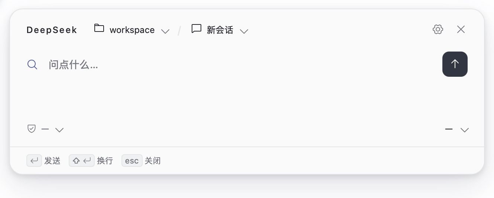
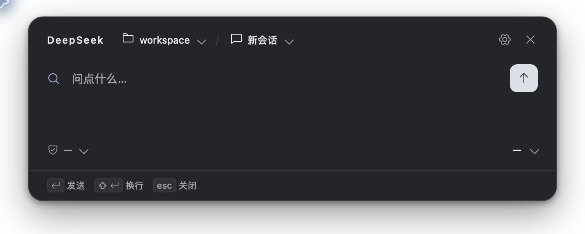

# dsh-quorfloat

简体中文 | [English](README_EN.md) | [npm](https://www.npmjs.com/package/dsh-quorfloat)

DeepSeek Harness 的桌面悬浮窗会话插件。通过全局快捷键呼出面板，在使用其他应用时也能向 Harness 提问、继续已有会话、查看回答和处理审批。

面板使用 Harness 的工作区、会话、模型和权限设置，对话执行与历史记录仍由 Harness 管理。离线发布包自带宿主插件和面板程序；通过 npm 安装时，包管理器会自动获取当前平台的面板程序。两种方式均无需自行编译。

## 界面预览

<table>
  <tr>
    <td></td>
    <td></td>
  </tr>
</table>

## 功能

- **随时呼出**：全局快捷键显示或收起悬浮窗；支持拖动并记住窗口位置，可设置失焦后保持展开。
- **工作区与会话切换**：浏览当前工作区的已有会话，选择其他工作区开始新对话，也可浏览未分组会话。
- **固定常用入口**：固定会话后，下次呼出继续该会话；在新会话状态下，可固定工作区作为默认创建位置。
- **完整对话阅读**：支持 Markdown、代码块和表格；工作过程可展开或折叠，回答可复制。长会话支持加载更早内容，并保持当前阅读位置。
- **会话控制**：发送消息、停止生成，选择 Harness 提供的模型、推理档位和权限预设，查看可用的会话统计。
- **审批与追问**：在面板中处理当前会话的工具审批和问题，无需切回 Harness 主窗口。
- **外观与语言**：支持浅色、深色及跟随系统主题，中英文界面，自定义呼出快捷键；设置自动保存。
- **诊断导出**：设置页可把当前状态快照写入 `~/.dsh-quorfloat/logs/`，并显示文件路径。

## 安装

### 准备

安装 DeepSeek Harness。使用浏览器 WebUI 时，还需确保终端可以运行 `dsh` 命令。

npm 主包名为 **`dsh-quorfloat`**，只需安装这个主包，平台依赖会自动安装。

离线安装请下载当前版本对应操作系统的自包含 tgz，例如：

- **macOS**：`dsh-quorfloat-<version>-darwin.tgz`，同时支持 Apple Silicon 和 Intel。
- **Windows**：`dsh-quorfloat-<version>-win32.tgz`，选择适用于当前机器架构的发布包。

下方示例中的 `<version>` 是占位符，请替换为下载文件或待安装版本的实际版本号。

### 浏览器 WebUI

先停止正在运行的 `dsh web` 服务。以下命令安装到 `web` profile；若使用自定义 profile，将 `web` 替换为自己的 profile 名称，并用相同 profile 启动 Harness。

远程访问 WebUI 时只能安装和查看插件状态；悬浮窗运行在 DSH 主机上，不会出现在浏览器所在的机器。

#### npm 安装

联网安装最新版本：

```bash
dsh plugin --profile web add dsh-quorfloat
dsh web
```

如需固定版本，使用 `dsh-quorfloat@<version>` 替换包名。

#### 离线安装（tgz）

使用本地 tgz 的**绝对路径**安装，无需解压。macOS 示例：

```bash
dsh plugin --profile web add "/绝对路径/dsh-quorfloat-<version>-darwin.tgz"
dsh web
```

Windows 示例：

```powershell
dsh plugin --profile web add "C:/Downloads/dsh-quorfloat-<version>-win32.tgz"
dsh web
```

路径包含空格时保留外层引号。

### Harness 官方桌面版

先启动桌面应用，在左侧栏打开“插件”，点击“添加插件”。

#### npm 安装

1. 点击左侧栏 “插件” -> "添加插件"，在添加插件弹窗输入 **`dsh-quorfloat`**，或指定版本 **`dsh-quorfloat@<version>`**。
2. 点击安装；若出现启用提示，按提示启用插件。包管理器会自动安装当前平台的面板程序。
3. 完全退出并重新启动 Harness 桌面应用。

#### 离线安装（tgz）

1. 下载当前操作系统对应的自包含 tgz，无需解压。
2. 在添加插件弹窗输入 tgz 的**绝对路径**，例如 macOS 的 `/绝对路径/dsh-quorfloat-<version>-darwin.tgz`，或 Windows 的 `C:/Downloads/dsh-quorfloat-<version>-win32.tgz`。
3. 点击安装；若出现启用提示，按提示启用插件。
4. 完全退出并重新启动 Harness 桌面应用。

**安装或更新后需要重启 Harness 本体。** 仅关闭悬浮窗、关闭桌面窗口或刷新 WebUI 页面不足以重新加载宿主插件。

## 开始使用

默认快捷键为 **Alt + Space**，macOS 上对应 **Option + Space**。按下后呼出面板，再次按下可收起；也可通过菜单栏或系统托盘入口操作。

在输入框中输入消息，按 **Enter** 发送，**Shift + Enter** 换行。生成过程中可以停止生成。按 **Esc** 会优先关闭已打开的菜单或返回对话页；若已在对话页且没有打开菜单，则收起面板。收起面板不会停止正在执行的会话。

点击顶部工作区或会话名称打开选择器：

- **开始新对话**：选择真实工作区，在会话菜单中选择“新会话”。会话会在首次发送消息时创建。
- **继续已有会话**：从会话列表中选择要继续的对话。
- **下次继续同一会话**：点击会话旁的固定按钮。没有固定会话时，下次呼出默认进入新会话状态。
- **设置默认工作区**：在新会话状态下，点击工作区旁的固定按钮。
- **浏览未分组**：选择“未分组”查看没有工作区归属的已有会话。该入口不能固定，且不提供“新会话”选项。

点击齿轮进入设置，可调整主题、界面语言、快捷键和“失焦时保持展开”。默认快捷键若与其他应用冲突，可从菜单栏或系统托盘打开面板后更换。

在 Harness 的“设置 → 内置插件 → dsh-quorfloat”页可点击“导出诊断”，把当前状态快照写入 DSH 主机上的 `~/.dsh-quorfloat/logs/`，页面会显示文件路径。

## 从源码构建

### 构建环境

- **Node.js 与 npm**：建议使用 Node.js 22 或更新版本，并确保 `node`、`npm` 在 PATH 中。
- **Rust**：使用 rustup 安装 Rust 1.88 或更新版本，并确保 `cargo`、`rustc` 在 PATH 中。
- **macOS**：安装 Xcode Command Line Tools，提供 SDK、链接器和 `lipo`。默认发布构建包含 Apple Silicon 与 Intel 两种架构。
- **Windows**：安装 Visual Studio Build Tools，勾选“使用 C++ 的桌面开发”，包含 MSVC 和 Windows SDK；使用 MSVC Rust 工具链，并安装 WebView2 Runtime。当前 npm 平台包面向 Windows x64。

平台依赖的安装步骤可参考 [Tauri 环境准备文档](https://v2.tauri.app/start/prerequisites/)。当前发布脚本支持 macOS 和 Windows；请在对应系统上构建对应平台的产物。

### 准备源码与依赖

下载并解压项目源码，在终端进入项目根目录。首次构建先安装前端依赖：

```bash
npm run frontend:install
```

宿主插件的 TypeScript 工具链会在构建时自动安装到 `.tooling/`，Rust 依赖由 Cargo 自动获取，因此首次构建需要联网。

macOS 默认构建通用二进制，需提前安装两个 Rust target：

```bash
rustup target add aarch64-apple-darwin x86_64-apple-darwin
```

### 构建离线安装包

在项目根目录执行：

```bash
npm run build
```

该命令依次编译宿主插件、面板前端与 release 悬浮窗，然后组装 bundle 并自动执行 npm 打包，无需再手动运行 `npm pack`。

产物位于 `bundles/`，路径中的 `<version>` 为源码声明的版本号：

| 平台 | bundle 目录 | 离线安装包 |
|---|---|---|
| macOS | `bundles/dsh-quorfloat-<version>-darwin/` | `bundles/dsh-quorfloat-<version>-darwin.tgz` |
| Windows | `bundles/dsh-quorfloat-<version>-win32/` | `bundles/dsh-quorfloat-<version>-win32.tgz` |

macOS 产物通过 `lipo` 合并为双架构二进制；Windows 离线包默认采用当前 Rust 工具链的宿主架构。使用新生成的 tgz，按上方安装方式安装后重启 Harness。

### 本地开发构建

```bash
npm run build:local
```

该命令构建宿主插件、面板前端和当前机器的 debug 悬浮窗，不生成发布 tgz。宿主产物位于 `lib/`，前端产物位于 `quorfloat/frontend/dist/`，悬浮窗位于 `quorfloat/target/debug/dsh-quorfloat`（Windows 为 `dsh-quorfloat.exe`）。也可分别使用 `build:plugin`、`build:frontend`、`build:sidecar`；其中 `build:sidecar` 会先构建前端，再编译悬浮窗。

发布版本取自根目录 `package.json` 与 `quorfloat/Cargo.toml`，两处版本号必须一致，否则发布构建会在编译前拒绝继续。
