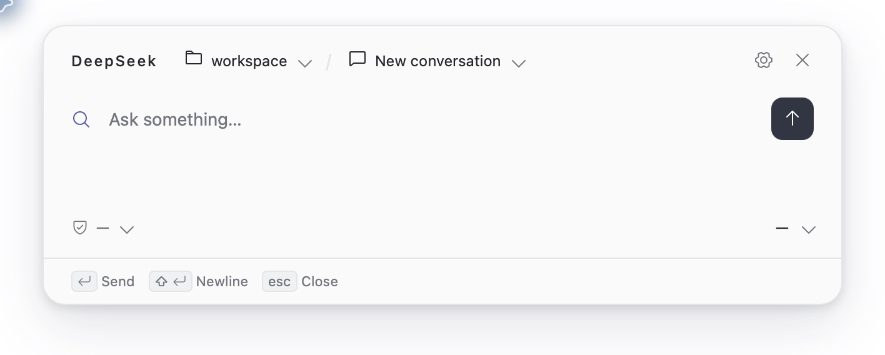
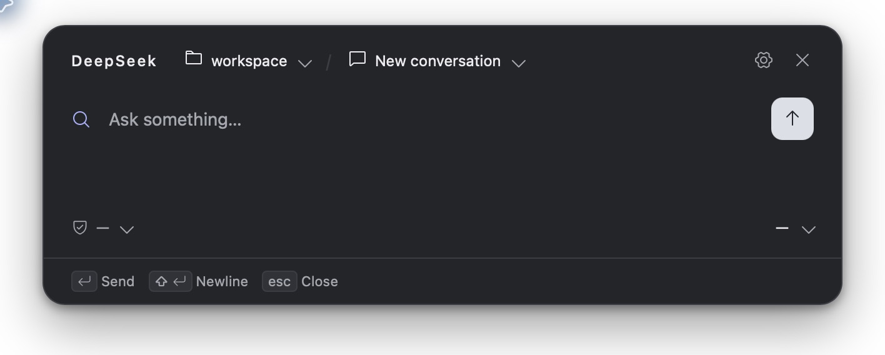

# dsh-quorfloat

[简体中文](README.md) | English | [npm](https://www.npmjs.com/package/dsh-quorfloat)

A floating desktop chat plugin for DeepSeek Harness. Bring up the panel with a global keyboard shortcut to ask Harness questions, continue existing sessions, read responses, and handle approvals while using other applications.

The panel uses Harness's workspaces, sessions, models, and permission settings. Harness manages conversation execution and history. Offline releases include both the host plugin and the panel application; when installing via npm, the package manager automatically downloads the panel application for your platform. Neither installation method requires compiling anything yourself.

## Interface Preview

<table>
  <tr>
    <td></td>
    <td></td>
  </tr>
</table>

## Features

- **Open anytime**: Show or hide the floating window with a global shortcut. Drag it to reposition it, have its position remembered, and optionally keep it open when it loses focus.
- **Switch workspaces and sessions**: Browse existing sessions in the current workspace, choose another workspace to start a new conversation, or browse ungrouped sessions.
- **Pin frequent destinations**: Pin a session to resume it the next time you open the panel. While in the new-session state, pin a workspace as the default location for new sessions.
- **Read full conversations**: Supports Markdown, code blocks, and tables. Expand or collapse the work process and copy responses. Load earlier content in long sessions while keeping your current reading position.
- **Control sessions**: Send messages, stop generation, select models, reasoning levels, and permission presets provided by Harness, and view available session statistics.
- **Approvals and follow-up questions**: Handle tool approvals and questions for the current session directly in the panel, without switching back to the main Harness window.
- **Appearance and language**: Light, dark, and system themes; Chinese and English interfaces; customizable global shortcut. Settings are saved automatically.

## Installation

### Prerequisites

Install DeepSeek Harness. If you use the browser WebUI, also make sure the `dsh` command is available in your terminal.

The main npm package is **`dsh-quorfloat`**. Install only this package; platform dependencies are installed automatically.

For offline installation, download the self-contained tgz for your operating system and the current release, for example:

- **macOS**: `dsh-quorfloat-<version>-darwin.tgz`, supporting both Apple Silicon and Intel.
- **Windows**: `dsh-quorfloat-<version>-win32.tgz`. Choose the release package that matches your machine's architecture.

In the examples below, `<version>` is a placeholder. Replace it with the actual version of the downloaded file or the version you want to install.

### Browser WebUI

First, stop the running `dsh web` service. The commands below install into the `web` profile. If you use a custom profile, replace `web` with your profile name and start Harness with the same profile.

#### npm installation

Install the latest version with an internet connection:

```bash
dsh plugin --profile web add dsh-quorfloat
dsh web
```

To install a specific version, replace the package name with `dsh-quorfloat@<version>`.

#### Offline installation (tgz)

Install using the **absolute path** to the local tgz. No extraction is needed. On macOS:

```bash
dsh plugin --profile web add "/absolute/path/dsh-quorfloat-<version>-darwin.tgz"
dsh web
```

On Windows:

```powershell
dsh plugin --profile web add "C:/Downloads/dsh-quorfloat-<version>-win32.tgz"
dsh web
```

Keep the surrounding quotation marks if the path contains spaces.

### Official Harness Desktop App

Launch the desktop app, open “Plugins” in the left sidebar, and click “Add Plugin”.

#### npm installation

1. Click “Plugins” → “Add Plugin” in the left sidebar. Enter **`dsh-quorfloat`** in the Add Plugin dialog, or **`dsh-quorfloat@<version>`** for a specific version.
2. Click Install. If prompted to enable the plugin, follow the prompt. The package manager automatically installs the panel application for your platform.
3. Fully quit and restart the Harness desktop app.

#### Offline installation (tgz)

1. Download the self-contained tgz for your operating system. No extraction is needed.
2. Enter the tgz's **absolute path** in the Add Plugin dialog, such as `/absolute/path/dsh-quorfloat-<version>-darwin.tgz` on macOS or `C:/Downloads/dsh-quorfloat-<version>-win32.tgz` on Windows.
3. Click Install. If prompted to enable the plugin, follow the prompt.
4. Fully quit and restart the Harness desktop app.

**Restart Harness itself after installing or updating the plugin.** Closing only the floating panel, closing the desktop window, or refreshing the WebUI page is insufficient to reload the host plugin.

## Getting Started

The default shortcut is **Alt + Space**, or **Option + Space** on macOS. Press it to open the panel, and press it again to hide it. You can also use the menu bar or system tray entry.

Type a message in the input box and press **Enter** to send it, or **Shift + Enter** to insert a line break. You can stop generation while it is in progress. **Esc** first closes an open menu or returns to the conversation page. If you are already on the conversation page with no menu open, it hides the panel. Hiding the panel does not stop a running session.

Click the workspace or session name at the top to open its selector:

- **Start a new conversation**: Select an actual workspace, then choose “New session” from the session menu. The session is created when you send the first message.
- **Continue an existing session**: Select the conversation you want to resume from the session list.
- **Resume the same session next time**: Click the pin button beside the session. Without a pinned session, the panel defaults to the new-session state the next time it opens.
- **Set a default workspace**: While in the new-session state, click the pin button beside a workspace.
- **Browse ungrouped sessions**: Select “Ungrouped” to view existing sessions that do not belong to a workspace. This entry cannot be pinned and does not offer a “New session” option.

Click the gear icon to adjust the theme, interface language, shortcut, and “Keep open when unfocused” setting. If the default shortcut conflicts with another application, open the panel from the menu bar or system tray and change it in Settings.

## Building from Source

### Build Environment

- **Node.js and npm**: Node.js 22 or newer is recommended. Make sure `node` and `npm` are on PATH.
- **Rust**: Install Rust 1.88 or newer with rustup. Make sure `cargo` and `rustc` are on PATH.
- **macOS**: Install Xcode Command Line Tools for the SDK, linker, and `lipo`. Release builds include both Apple Silicon and Intel architectures by default.
- **Windows**: Install Visual Studio Build Tools with the “Desktop development with C++” workload, including MSVC and the Windows SDK. Use the MSVC Rust toolchain and install the WebView2 Runtime. The current npm platform package targets Windows x64.

See the [Tauri prerequisites guide](https://v2.tauri.app/start/prerequisites/) for platform dependency setup. The release scripts currently support macOS and Windows. Build each platform's artifacts on that operating system.

### Prepare the Source and Dependencies

Download and extract the project source, then open a terminal in the project root. Before your first build, install the frontend dependencies:

```bash
npm run frontend:install
```

The build automatically installs the host plugin's TypeScript toolchain into `.tooling/`, and Cargo downloads Rust dependencies. Your first build therefore requires an internet connection.

The default macOS build produces a universal binary. Install both Rust targets beforehand:

```bash
rustup target add aarch64-apple-darwin x86_64-apple-darwin
```

### Build an Offline Installation Package

Run from the project root:

```bash
npm run build
```

This command compiles the host plugin, panel frontend, and release sidecar in order, then assembles the bundle and automatically packs it with npm. There is no need to run `npm pack` manually.

Outputs are placed in `bundles/`. In these paths, `<version>` is the version declared by the source:

| Platform | Bundle directory | Offline installation package |
|---|---|---|
| macOS | `bundles/dsh-quorfloat-<version>-darwin/` | `bundles/dsh-quorfloat-<version>-darwin.tgz` |
| Windows | `bundles/dsh-quorfloat-<version>-win32/` | `bundles/dsh-quorfloat-<version>-win32.tgz` |

The macOS binary combines both architectures using `lipo`. The Windows offline package defaults to the host architecture of the current Rust toolchain. Install the newly generated tgz using the instructions above, then restart Harness.

### Build Packages for npm Publishing

```bash
npm run build:npm
```

Outputs are placed in `bundles/npm/<version>/`, containing the main package directory `dsh-quorfloat/`, the current platform dependency directory, and their respective tgz files. The dependency directory is `azetus-dsh-quorfloat-darwin/` on macOS or `azetus-dsh-quorfloat-win32-x64/` on Windows. This command only builds and packs; it does not publish. Build the two platform dependencies separately on their corresponding operating systems.

### Local Development Build

```bash
npm run build:local
```

This command builds the host plugin, panel frontend, and debug sidecar for the current machine without producing a release tgz. Host artifacts are placed in `lib/`, frontend assets in `quorfloat/frontend/dist/`, and the sidecar at `quorfloat/target/debug/dsh-quorfloat` (`dsh-quorfloat.exe` on Windows). You can also use `build:plugin`, `build:frontend`, and `build:sidecar` separately. `build:sidecar` builds the frontend before compiling the sidecar.

The release version comes from the root `package.json` and `quorfloat/Cargo.toml`. Their version numbers must match; otherwise, the release build stops before compilation.
